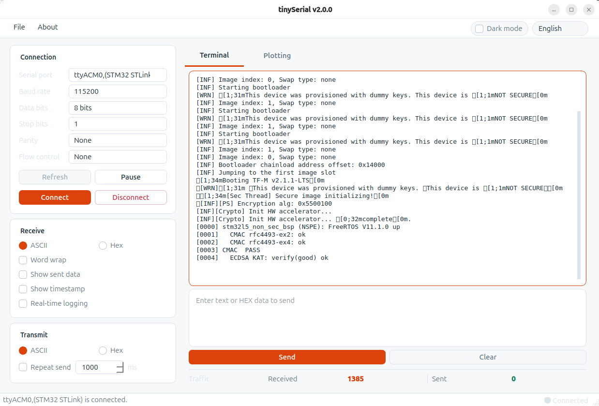
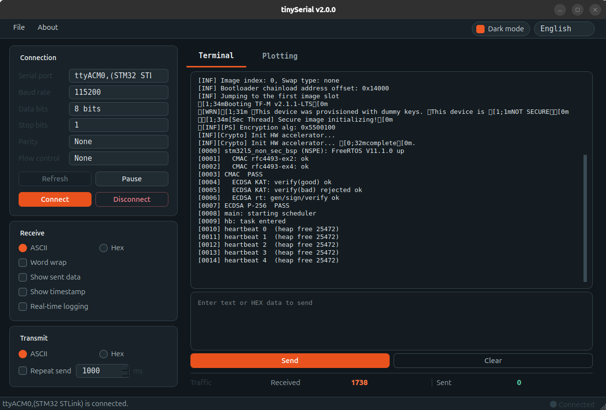

# TinySerial

A small, fast serial port terminal for talking to microcontrollers, boards and modems over UART. Built with Qt 5 or Qt 6.

Website: https://tinyserial.mltz.tech



## Features

- Port list refreshes when a USB-serial adapter is plugged in or removed
- Text or HEX, chosen separately for sending and receiving; Text supports UTF-8, GB18030, GBK, GB2312, Big5, Shift-JIS, EUC-KR, ISO-8859-1 and Windows-1252
- Optional C-style escape sequences (`\\n`, `\\r`, `\\t`, `\\xHH`) and a configurable send line ending
- Repeat sending at a fixed interval in milliseconds
- Optional timestamps and echo of sent data
- Save the session to a log file, or log to a file continuously while it runs
- Timeline tab: every received line, send and connection event with millisecond times, the delay before the device answered a send, filters and search, and CSV or JSON Lines export
- Standard or custom baud rates, data bits, parity, stop bits and flow control
- Control lines: CTS, DSR, CD and RI lights in the status bar next to RX/TX, DTR and RTS checkboxes, and a reset pulse on DTR or RTS for Arduino- and ESP32-style boards
- Light and dark themes; English, Chinese and Spanish interface
- Full terminal mode for keyboard-driven serial work, with the selected port, baud rate, data/stop bits, parity, flow control and logging controls kept visible
- A fixed dark terminal surface in full terminal mode, with a configurable monospace font, terminal-cache limit, RX/TX activity lights and status-word highlighting
- XMODEM (checksum, CRC and 1K) and YMODEM send/receive file transfer

## What's new in v2.1.0

### Full terminal workflow

Switch between the normal **Debug mode** and a keyboard-first **Full terminal mode**. Full terminal mode behaves like a dedicated serial console: typed characters are sent directly to the connected port, including common control characters such as `Ctrl+A` through `Ctrl+Z`, `Enter`, `Tab`, `Backspace` and `Esc`. The terminal keeps its own dark visual surface regardless of the application theme, with a visible caret and a focused, monospace reading area.

The terminal toolbar keeps the connection controls available instead of forcing a return to the debug screen: port, baud rate, data bits, stop bits, parity, flow control, connect/disconnect, real-time logging and opening the log directory are all available in one place.

### More useful terminal output

The terminal font and retained text cache can be configured from the **View** menu. RX and TX lamps in the status bar flash orange when bytes actually arrive or leave the serial port. Common status words are highlighted without colouring the rest of a line: failures such as `error`, `failed`, `timeout`, `失败` and `错误` are red; successful states such as `OK`, `success`, `ready`, `成功` and `完成` are green. English, Chinese and common Spanish status words are recognised.

### Text, HEX and logging controls

Text sending now supports UTF-8, GB18030, GBK, GB2312, Big5, Shift-JIS, EUC-KR, ISO-8859-1 and Windows-1252. Optional C-style escapes (`\\n`, `\\r`, `\\t`, `\\xHH`) and a selectable line ending make it practical to reproduce device protocols exactly. HEX input is validated before transmission.

Real-time logging can be enabled directly from either mode. On packaged Linux installations it uses `/var/log/tinyserial` when writable, otherwise a per-user log directory; a user-selected directory is remembered and can be opened from the File menu.

### File transfer

The File menu can now send or receive with XMODEM checksum, XMODEM-CRC, XMODEM-1K and YMODEM. Transfer progress, cancellation and protocol traffic are handled without mixing protocol bytes into normal terminal output.



## Install on Ubuntu

Packages are published for Ubuntu 20.04, 22.04, 24.04 and 26.04 (amd64). Paste this block; it picks the apt suite for your release and adds you to the `dialout` group:

```bash
(
  . /etc/os-release
  case "$VERSION_ID" in
    20.04) suite=focal ;;
    22.04) suite=jammy ;;
    24.04) suite=noble ;;
    26.04) suite=resolute ;;
    *) echo "Ubuntu ${VERSION_ID:-unknown} is not a published TinySerial target." >&2; exit 1 ;;
  esac
  sudo curl -fsSL https://apt.mltz.tech/key.gpg -o /usr/share/keyrings/mltz.gpg
  echo "deb [signed-by=/usr/share/keyrings/mltz.gpg] https://apt.mltz.tech ${suite} main" | sudo tee /etc/apt/sources.list.d/mltz.list
  sudo apt-get update
  sudo apt-get install -y tinyserial
  sudo usermod -a -G dialout "$USER"
)
```

Log out and back in once so the `dialout` group applies, then open TinySerial from the application menu or run `tinyserial`.

## Build from source

With qmake and Qt 5:

```bash
sudo apt-get update
sudo apt-get install -y build-essential qt5-qmake qtbase5-dev libqt5serialport5-dev
git clone https://github.com/carloscn/tinyserial.git
cd tinyserial
qmake SerialPort.pro
make -j"$(nproc)"
./tinyserial
```

With CMake, which uses Qt 6 when it is installed and Qt 5 otherwise:

```bash
sudo apt-get install -y build-essential cmake ninja-build qtbase5-dev libqt5serialport5-dev
cmake -S . -B build-cmake -G Ninja -DBUILD_TESTING=ON
cmake --build build-cmake
ctest --test-dir build-cmake --output-on-failure
./build-cmake/tinyserial
```

Windows and macOS are not packaged; build them the same way with qmake or CMake.

Requirements: Qt 5.12 or newer, and permission to open serial devices (`dialout` on Ubuntu).

## Usage

1. Pick the port. The list follows hot-plug events; Refresh rescans at once.
2. Set baud rate, data bits, stop bits, parity and flow control, then Connect.
3. Type in the send box, choose Text or HEX, and press Send, or enable Repeat send. In Text mode, choose the encoding, optionally enable escape sequences, and select a line ending to append.
4. Received data appears in the Terminal tab. Pause stops the display; data keeps arriving.
5. File > Save Log File exports the session.

Real-time logging writes the traffic to a file as it arrives. Packaged Linux installs use `/var/log/tinyserial`; other builds fall back to the user's application data directory when that is not writable.

## Troubleshooting

**TinySerial is missing from the application menu.** Reinstall it; packages older than 1.5.2 removed the menu entry while upgrading:

```bash
sudo apt-get update
sudo apt-get install -y --reinstall tinyserial
```

**No serial ports, or permission denied.** Add yourself to `dialout`, then log out and back in. The install block already does this.

```bash
sudo usermod -a -G dialout "$USER"
```

**It does not start.** Install it with apt so the Qt libraries for your Ubuntu release are present, and check that `/opt/tinyserial/tinyserial` exists.

**HEX input is rejected.** Bytes may be separated by spaces, but each byte needs exactly two hex digits, for example `01 AB FF`.

More package details: [tinyserial-deb-prj/README.md](tinyserial-deb-prj/README.md).

## Packaging and releases

Build a `.deb` for the Ubuntu you are on (output: `dist/tinyserial_<version>_ubuntu<release>_amd64.deb`):

```bash
sudo apt-get install -y qt5-qmake qtbase5-dev libqt5serialport5-dev dpkg-dev
./script/build-deb.sh
```

Build packages for all four Ubuntu releases with Docker. The Qt toolchain for each release is cached; on a machine where `/hrom` is writable the cache is `/hrom/tinyserial/buildkit`.

```bash
./script/build-docker.sh
```

Publish: raise `Version` in `tinyserial-deb-prj/DEBIAN/control`, then run `./script/release.sh` (needs a logged-in `gh`). It uploads `dist/tinyserial_*_ubuntu*.deb` to a GitHub Release, and the release workflow copies them to apt.mltz.tech.

`gen_deb.sh` fills the package `Depends` line from the binary on the build machine. Qt already depends on X11, zlib and GLib, so those are not listed again.

## Roadmap

- Data plotting (the Plotting tab is a placeholder for now)
- Better custom baud rate support
- macOS polish
- Scripted sending

## Contributing

Bug reports and pull requests are welcome: https://github.com/carloscn/tinyserial/issues

Related: [tinyNetwork](https://github.com/carloscn/tinyNetwork), a network debugging tool by the same author.

## License

Mozilla Public License 2.0. See [LICENSE](LICENSE).

Carlos Wei · carlos.wei.hk@gmail.com · https://mltz.tech
